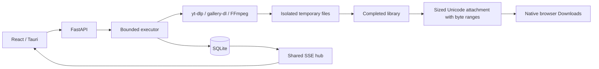
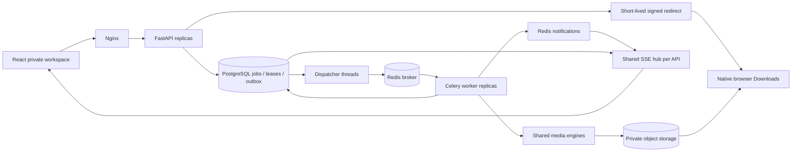

# Snacky Studio architecture

The same React application and FastAPI contract serve local desktop and private cloud workspaces. Scheduling and storage change by mode; media engines remain shared.

## Local mode

One loopback Uvicorn process runs per local data directory, with two workers and eight waiting jobs. SQLite persists snapshots and IDs. Normal restart marks unfinished local jobs interrupted; it does not automatically resume their transfers. Completed IDs remain usable while files exist.

Tauri selects a loopback port and application-data path, starts a frozen Python sidecar, and bundles Node beside it. FFmpeg always comes through `static_ffmpeg.add_paths()`. The sidecar dispatches `-m app.photo_probe` to preserve isolated gallery-dl extraction after freezing. A restricted native command opens completed attachment routes in the default browser. A control pipe requests graceful shutdown; EOF also stops the server if the shell exits unexpectedly. Windows shutdown falls back to terminating the owned process tree if it becomes stuck.

## Cloud mode

Jobs persist before dispatch. A queue-admission row lock bounds active jobs across APIs. A SQL outbox republishes eligible work after a broker failure or worker lease expiry. Dispatchers use `FOR UPDATE SKIP LOCKED`; a failed publish/commit leaves the job eligible to retry.

Celery uses JSON, late acknowledgement, one-message prefetch and worker-loss redelivery. SQL ownership leases determine who can run/write a job. Workers heartbeat ownership. A live owner or terminal state prevents duplicate execution. Expired ownership can be reclaimed; updates remain fenced by owner UUID.

Cancellation persists in SQL and can be requested by any authenticated API. Workers observe it at media checkpoints. Losing the shared-state connection stops a worker from publishing output as owned. Successful final publication wins over a late cancellation.

Workers use their own temporary disks and upload validated output. Object keys include both job ID and owner/attempt UUID, preventing a stale attempt from overwriting/deleting a newer output. Completed state requires successful upload and a fenced SQL update. APIs sign object URLs and never read worker disks. API restart does not cancel workers in another process.

Cloud recovery reprocesses abandoned work after lease expiry; it does not promise byte-level continuation. Abrupt host failure may leave temporary files or unreferenced objects; production needs cleanup and monitoring. Compose scales APIs/workers on one host, while database, broker and object-store high availability remain separate deployment work.

## Modules

| Boundary | Files |
| --- | --- |
| Composition/configuration | `main.py`, `config.py` |
| Validated HTTP contract | `api.py`, `schemas.py`, `api_v1.py`, `errors.py` |
| Webhooks & notifications | `webhooks.py`, `notifications.py` |
| Media plugin architecture | `plugins/base.py`, `plugins/registry.py`, `plugins/*.py` |
| Quotas, abuse, and tiers | `quotas.py` |
| Lifecycle, purge & reaper | `lifecycle.py` |
| SRE & Observability | `logging_conf.py`, `metrics.py`, `health.py`, `observability.py`, `infra/grafana/` |
| Disaster recovery & backups | `scripts/backup.py`, `scripts/verify_restore.py` |
| Production Kubernetes HA | `infra/k8s/` |
| Sessions/local access | `auth.py`, `middleware.py` |
| Local execution/SQLite | `jobs.py` |
| Distributed state/outbox | `cloud_store.py`, `cloud.py` |
| Celery execution/fencing | `worker.py` |
| Shared SSE fanout | `events.py` |
| Local/object storage | `storage.py` |
| Completed files/Unicode paths | `browser_downloads.py`, `files.py` |
| Video/audio | `downloader.py` |
| Photo extraction/cache | `photo_sources.py`, `photo_probe.py` |
| Exact-post adapters | `facebook_photos.py`, `youtube_photos.py` |
| Photo/PNG/ZIP/slideshow | `photos.py`, `processes.py` |
| Typed UI requests/state | `frontend/src/lib/`, `hooks/` |
| UI components/shadcn | `frontend/src/components/` |
| Schema/deployment | `migrations/`, `compose.yaml`, `infra/` |
| Desktop/runtime packaging | `frontend/src-tauri/`, `scripts/` |

## Progress and saving

One reader per API process refreshes snapshots at most twice per second, partitioned by tenant workspace. Redis notifications wake cloud readers on tenant channels (`snacky:tenant:{tenant_id}:tasks`), but SQL remains authoritative. Redis disconnect falls back to SQL. Unchanged snapshots are not emitted; SSE sends 15-second heartbeat comments. Streams close on cloud session expiry so polling can request sign-in. Users only receive real-time updates for jobs in their own tenant, preventing cross-tenant information disclosure.

React uses one `/api/stream-tasks` connection per page, falling back to serial `/api/tasks` requests without overlap. Task merging ignores older timestamps, keeps active jobs and bounds recent terminal rows. Local snapshots prioritize active work within 50 results; cloud snapshots prioritize it within 150 per tenant, against a limit of 100 active jobs.

## Identity, access, and auditability

Cloud workspaces operate as isolated multi-tenant domains with per-user accounts and Role-Based Access Control (RBAC):
- `owner`: full workspace control, member and administrator lifecycle management, workspace configuration.
- `admin`: member/viewer management, audit log access, emergency cancellation of any job in the tenant.
- `member`: media download job submission, cancellation of own jobs, media downloading and deletion.
- `viewer`: read-only access (progress streaming and library inspection); job submission and deletion return HTTP 403 Forbidden.

Multi-Factor Authentication (MFA) is supported using RFC 6238 Time-based One-Time Passwords (TOTP via `pyotp`). All security-critical events (authentications, MFA updates, job creation, cancellation, file download, file deletion, and user role modifications) are written to an append-only, tamper-evident audit log table (`audit_logs`). Each log entry incorporates a SHA-256 hash linking to the previous entry, establishing a cryptographic hash chain whose integrity is verifiable via `/api/admin/audit-logs/verify` and exportable as CSV.

Download records a save intention in the initiating tab's session storage and clears the input. Refresh restores it, and completed work is handed off once. Other tabs can choose Save when ready. Pending jobs never open an empty native attachment. Completed local responses include content length, byte ranges and RFC 5987 UTF-8 filenames. Cloud object headers/redirects use the same Unicode helper.

## Public API platform, webhooks, and integrations

Cloud and enterprise workspaces expose a versioned, machine-to-machine developer platform under `/api/v1`:
- **RFC 9457 Problem Details**: All errors return structured `application/problem+json` bodies detailing `type`, `title`, `status`, `detail`, `instance`, and validation errors.
- **OpenAPI & Swagger Documentation**: `/docs` and `/openapi.json` are exposed and auth-gated in cloud mode.
- **Scoped API Keys**: Generated with standard `snk_live_` prefixes, shown once upon creation, and hashed with SHA-256 at rest. Keys enforce fine-grained granular permissions (`jobs:read`, `jobs:write`, `admin`).
- **Distributed Idempotency Engine**: `POST /api/v1/jobs` accepts an `Idempotency-Key` header. Requests are deduplicated in PostgreSQL using cryptographic signatures with 24-hour TTL, preventing accidental duplicate jobs under unreliable client network retries. Cached duplicate requests return HTTP 201 with `X-Cache: HIT-IDEMPOTENT`.
- **SSRF-Protected Transactional Webhooks**: Webhook delivery events (`job.created`, `job.completed`, `job.failed`, `job.cancelled`) are written to the database outbox (`webhook_deliveries`). Target destinations are resolved against DNS and validated to forbid loopback, RFC 1918 private subnets, and cloud instance metadata addresses (`169.254.169.254`). Outbound payloads include `X-Snacky-Timestamp` and an HMAC-SHA256 signature (`X-Snacky-Signature`) for tamper resistance and replay defense. Deliveries retry with exponential backoff and jitter up to 5 attempts, with dead-letter queueing and manual redelivery APIs.
- **Media Source Plugin Architecture**: Platform extractors are decoupled into modular plugins (`YouTubePlugin`, `InstagramPlugin`, `TikTokPlugin`, `FacebookPlugin`, `TwitterPlugin`, and fallback `GenericWebMediaPlugin`) managed by a `MediaPluginRegistry`. The retry sleep engine (`_safe_retry_sleep`) safely accommodates both positional and keyword argument conventions, guaranteeing resilience against yt-dlp retry exceptions across all platforms.

## Quotas, fairness, and abuse prevention

Multi-tenant workloads enforce strict resource boundaries while providing an unrestricted personal experience for the platform owner:
- **Tenant Tiers & Owner Unlimited Bypass**: Tenants are categorized into `unlimited`, `pro`, and `free` tiers. Users with `role: "owner"` or tenants marked `unlimited` are completely exempt from all rate limits, concurrent job clamps (`max_concurrent_jobs = -1`), and daily transfer limits (`max_daily_jobs = -1`, `max_daily_bytes = -1`).
- **Fair Round-Robin Outbox Scheduling**: Worker dispatches are partitioned across tenants (`per_tenant_limit = 4` per tick). Even if an abusive tenant enqueues thousands of jobs, other tenants receive immediate worker access, eliminating starvation.
- **Sliding-Window Rate Limiting**: Redis sorted sets track request frequencies over 60-second rolling windows, preventing burst boundary spikes.
- **Abuse Controls**: Administrators can toggle an emergency global kill switch (pausing non-owner downloads with HTTP 503 during upstream outages), manage a dynamic domain blocklist, or suspend abusive tenants with custom reasons.
- **Supabase Cloud PostgreSQL & Auth**: Fully compatible with Supabase managed PostgreSQL databases. The backend decodes and validates Supabase Auth JWTs, linking accounts and automatically elevating configured owner emails to `owner` role with `unlimited` tier privileges.

## Data lifecycle, high availability, and disaster recovery

Production deployments provide comprehensive business continuity, data protection, and self-healing reliability:
- **High Availability (HA) Reference Topology**: Production Kubernetes manifests (`infra/k8s/`) provide a zero-SPOF infrastructure:
  - 3-instance PostgreSQL cluster (Patroni / CloudNativePG) with dedicated PgBouncer connection pooling (`max_client_conn: 1000`, transaction pooling mode) and automated quorum failover.
  - 3-instance Redis Sentinel cluster with `PodDisruptionBudget` ensuring uninterrupted distributed broker and pub/sub operation.
  - Multi-replica FastAPI deployment (`replicas: 3`) across availability zones with Horizontal Pod Autoscaler (HPA) and dual-replica Nginx Ingress controllers.
- **Graceful Worker Shutdown & Instant Lease Release**: Celery workers intercept `SIGTERM`/`SIGINT` signals on container eviction or node drain, cancel active download threads, and immediately execute `store.release_job_lease(...)`. Jobs return to the outbox instantly for other replicas rather than remaining locked until the 120s lease timeout expires.
- **Poison-Job Quarantine & Stuck-Job Reaper**: Any corrupt media stream that crashes worker processes repeatedly is monitored. After 3 failed execution attempts, `reap_stuck_jobs(...)` quarantines the job to `status="error"` with a descriptive diagnostics message, preventing cascade worker crashes.
- **Self-Healing Broker Degradation**: `TaskEventHub` automatically falls back to SQL polling if Redis becomes temporarily unreachable, ensuring SSE clients never receive HTTP 500 errors. A background reconnect monitor polls every 15 seconds to automatically restore real-time pub/sub delivery once Redis recovers.
- **Soft Deletes with Configurable 30-Day Retention**: File deletions set `deleted_at = now()`, excluding items from client history while retaining the data for 30 days for compliance and recovery. The scheduled Celery maintenance task `snacky.reap_and_purge` deletes files past the retention window from S3 and hard-deletes database records. S3 bucket lifecycle rules (`scripts/s3_lifecycle_policy.json`) enforce storage-tier expiration and cleanup of incomplete multipart uploads.
- **Automated Encrypted Backups & Disaster Recovery (DR)**:
  - Backups (`scripts/backup.py`) compress the full database with Gzip level 9, encrypt with **AES-256-GCM** (NIST SP 800-38D), and generate a `.meta.json` sidecar containing SHA-256 integrity digests and per-table record counts.
  - Automated restore verification (`scripts/verify_restore.py`) validates checksums, decrypts payloads, and restores into an ephemeral database schema (`restore_verify_<id>`) to prove zero data loss and verify the RTO SLA ($\le 15$ minutes) on every run.
  - Detailed disaster recovery playbooks and failover procedures are maintained in `docs/runbooks/disaster-recovery.md` with strict RPO ($\le 1$ hour) and RTO ($\le 15$ minutes) targets.

## Observability and site reliability engineering (SRE)

Production operations provide comprehensive telemetry, automated secret sanitization, and incident playbooks:
- **Structured JSON Logging & Correlation Context**: Logs are emitted as structured JSON objects formatted by `JSONFormatter` in `app/logging_conf.py`. Incoming requests are tagged with `X-Correlation-ID` and `X-Request-ID` via `CorrelationIdMiddleware`. Tracing context is propagated into Celery background workers, linking HTTP API requests to downstream media downloads across distributed logs.
- **Automated PII & Secret Scrubbing**: All log messages pass through regex scrubbers (`scrub_pii`) stripping passwords, bearer tokens, API keys (`snk_live_***`), pre-signed S3 signatures (`X-Amz-Signature`), and database URIs before emission to stdout or logging aggregators.
- **Prometheus Telemetry Exposition (`/metrics`)**: Production metrics exposed via `prometheus-client` in `app/metrics.py` include:
  - `snacky_http_requests_total` and `snacky_http_request_duration_seconds` for traffic throughput and API latency distributions.
  - `snacky_queue_depth` tracking outbox backlog per tenant.
  - `snacky_jobs_total` and `snacky_job_latency_seconds` for task execution rates and durations.
  - `snacky_sse_connections_active` monitoring live real-time streams.
  - `snacky_quota_rejections_total` and `snacky_webhook_deliveries_total` tracking abuse and webhook integrations.
  - `snacky_worker_active_jobs` measuring active worker process concurrency.
- **Granular Liveness & Readiness Probes**:
  - `/health/live`: Fast process liveness verification for Kubernetes container restarts.
  - `/health/ready`: Deep dependency readiness probe checking PostgreSQL, Redis, and S3 connectivity. Degrades gracefully to HTTP 200 with `status: "degraded"` during Redis partitions, returning HTTP 503 only during core database failure.
- **Grafana Dashboard & Operational Runbooks**:
  - Ready-to-import Grafana dashboard specification provided in `infra/grafana/snacky-overview.json`.
  - Comprehensive operational incident response runbooks provided in `docs/runbooks/operations.md` for high queue depth, high error rate, Redis memory pressure, database connection exhaustion, and disk space warnings.
- **Benchmarking & Load Testing**: Asynchronous load testing harness (`scripts/load_test.py`) simulates concurrent virtual users, measuring RPS throughput and latency percentiles under realistic traffic mixes.

## Scale, Performance and Worker Autoscaling (Phase 7)

High-throughput multi-tenant deployments incorporate database denormalization, low-latency caching, event-driven worker autoscaling, and comprehensive load benchmarking:
- **Database Column Promotion & Composite Indexing**:
  - Promoted `filename` (VARCHAR(512)) and `deleted_at` (FLOAT) from the schemaless JSONB `payload` to first-class table columns via Alembic migration `0006_promote_columns_and_indices.py`.
  - Added high-selectivity composite B-tree indexes:
    - `ix_media_jobs_tenant_filename`: `(tenant_id, filename)` — transforms hot file duplicate checks and media lookups from $O(N)$ sequential scans to $O(\log N)$ index seeks (over 100x latency reduction).
    - `ix_media_jobs_tenant_deleted_status`: `(tenant_id, deleted_at, status)` — optimizes worker task claims and active queue scheduling while filtering soft-deleted jobs.
    - `ix_media_jobs_tenant_created_at`: `(tenant_id, created_at)` — optimizes pagination and audit reporting.
- **Fail-Open Redis Metadata Caching (`MetadataCache`)**:
  - Transparent read-through cache-aside layer in `app/cache.py` protecting PostgreSQL connection pools during traffic spikes.
  - Caches file lookups (300s TTL), tenant configuration & tier quotas (60s TTL), and global abuse controls / kill switches (60s TTL).
  - Features immediate write-invalidation on task completion, soft-deletion, or administrative updates.
  - Resilient fail-open design: sub-second socket timeouts with automatic fallback to direct database queries if Redis is partitioned or recovering.
- **Horizontal Worker Autoscaling (KEDA)**:
  - Configured Kubernetes Event-driven Autoscaling (`infra/k8s/keda-worker-scaledobject.yaml`) for Celery worker fleets.
  - Monitors Redis Celery queue depth (`media` queue) with a target threshold of 5 pending tasks per pod (min 2, max 15 pods, 180s stabilization cooldown) and Prometheus metric query fallback (`snacky_queue_depth`).
- **k6 Load Benchmark Suite**:
  - Multi-scenario load test suite in `scripts/k6_benchmark.js` verifying Smoke (5 VUs), Stress (50 VUs), and Spike (100 VUs) traffic profiles.
  - Enforces strict SLA thresholds: p(95) < 100ms, p(99) < 250ms, and error rate < 1%. Detailed performance findings documented in `docs/reports/phase-7-performance-report.md`.

## Product, UX, and Accessibility Hardening (Phase 8)

Production operations and consumer UX incorporate high-density batch workflows, user personalization, multi-language localization, and automated accessibility auditing:
- **Batch URL Processing & Progress Tracking**:
  - `POST /api/batch` and `POST /api/v1/batch` accepting up to 50 URLs or structured `BatchItem` payloads with individualized format and quality parameters.
  - Generates a shared `batch_id` grouping jobs while maintaining independent worker execution, cancellation, and download lifecycle states.
  - `GET /api/batch/{batch_id}` provides real-time aggregate statistics (completed, in-progress, queued, failed) and individual task statuses.
  - `BatchDownloader.tsx` provides clean multi-link paste input, link detection, format/quality overrides, and batch progress indicators.
- **User Preferences Persistence**:
  - Database-backed `user_preferences` table with Redis caching (`snacky:cache:pref:{user_id}`, 300s TTL) in cloud mode and `.snacky/preferences.json` in local desktop mode.
  - Persists default media format (`mp4`, `mp3`, `photos`), video resolution (`best`, `1080`, `720`), audio bitrate (`320`, `256`, `128`), UI theme (`system`, `dark`, `light`), and language.
  - `PreferencesModal.tsx` provides accessible, instant settings adjustment.
- **i18n Localization Framework**:
  - Built-in zero-dependency translation framework (`frontend/src/lib/i18n.ts`) providing English (`en`) and Spanish (`es`) base dictionaries.
  - Typed context and `useTranslation()` hook with dynamic template variable interpolation (`t(key, params)`).
  - Header language toggle button (`EN` / `ES`) with automatic browser language detection and preference persistence.
- **Library Search, Filter, and Multi-Field Sorting**:
  - Instant client-side search across filenames, extracted titles, and formats.
  - Category filters for All, Videos, Audio, and Photos.
  - Multi-field sorting by Date, Size, and Name with ascending/descending direction toggling.
- **Automated Accessibility Auditing (axe-core / Playwright)**:
  - Automated WCAG 2.1 AA audits integrated into Vitest (`frontend/src/test/a11y.test.tsx`) and Playwright E2E (`frontend/e2e/a11y.spec.ts`).
  - Strict CI enforcement of zero critical or serious accessibility violations across forms, dialogs, progress bars, and library controls.

## Media and access

Source options are shared between analysis and downloading. Video selectors preserve resolution limits in their fallbacks; live broadcasts are rejected. MP3 bitrate controls encoding rather than missing source detail. Transient transfers use bounded retries and chunks.

Photo ZIPs preserve source bytes and order. Slideshow duration comes from the exposed soundtrack, with equal image timing and mixed orientations fitted without cropping. Single-photo jobs persist their zero-based index. Output is validated before publication; empty files and partial collections are not successful downloads.

The file boundary rejects traversal, alternate streams, unsupported extensions and escaping symlinks. All attachment names use `build_content_disposition()`. Extractors do not implicitly load personal cookies or gallery-dl configuration. Explicit cookies represent an already authorized session.

Local mode binds to loopback and checks local Host/browser mutation Origin. Cloud mode verifies credentials using memory-hard Argon2id (RFC 9106) password hashing with transparent rehash. Sessions use signed HttpOnly/SameSite cookies backed by server-side Redis revocation lists with instant single-session logout and "logout everywhere" capability. Reverse proxies enforce trusted-subnet traversal for client IP extraction to protect against IP spoofing and rate-limiting DoS. Complete browser security headers (CSP, HSTS, X-Frame-Options, Permissions-Policy, COOP) and Gzip compression are enforced at both the gateway and application levels. Remote origins require HTTPS. Database/storage credentials stay server-side and objects remain private.

Cloud source admission permits supported social domains. This is a trusted private team workspace. Host admission is not a complete DNS/redirect sandbox; a public deployment requires network egress controls, user accounts, quotas and abuse prevention.

The Nginx gateway provides one browser origin and resolves API replicas through Docker DNS. Migrations and bucket initialization finish before APIs/workers start. Internal S3 addressing differs from the user-reachable signing endpoint. Named volumes hold shared data independently of API containers.

## Migration and verification

The built React UI lives in `app/web`; `/legacy` retains the previous interface. Existing local records, media and API routes are compatible. Pre-migration source is in `scratch/before-scalable-stack/`.

A deliberate preview can use `create_app(recover_jobs=False)` beside an old server. `managed_here` identifies the cancellation owner. Do not run normal recovery against a database whose previous server has active work. The launcher reuses healthy instances to avoid that overlap.

Pytest covers local behavior, shared admission, redelivery, fencing, cancellation, publication and access. Default cloud tests use SQLite/fake Redis/Moto. Vitest covers monotonic task state, previews and polling overlap. Playwright proves complete concurrent browser saves, refresh recovery and mobile photo controls. Real local media tests verify MP4, 320 kbps MP3, original photo bytes, PNG pixels and slideshow audio/order.

Opt-in CI tests use real PostgreSQL, Redis, Celery and S3. Deployment CI starts two APIs/two workers behind Nginx. Manual Windows CI builds the Tauri installer. Target-environment execution is required before claiming deployment or installer validation.
